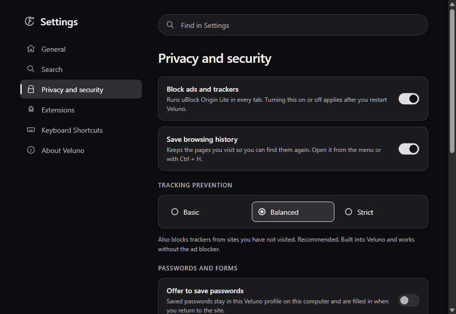
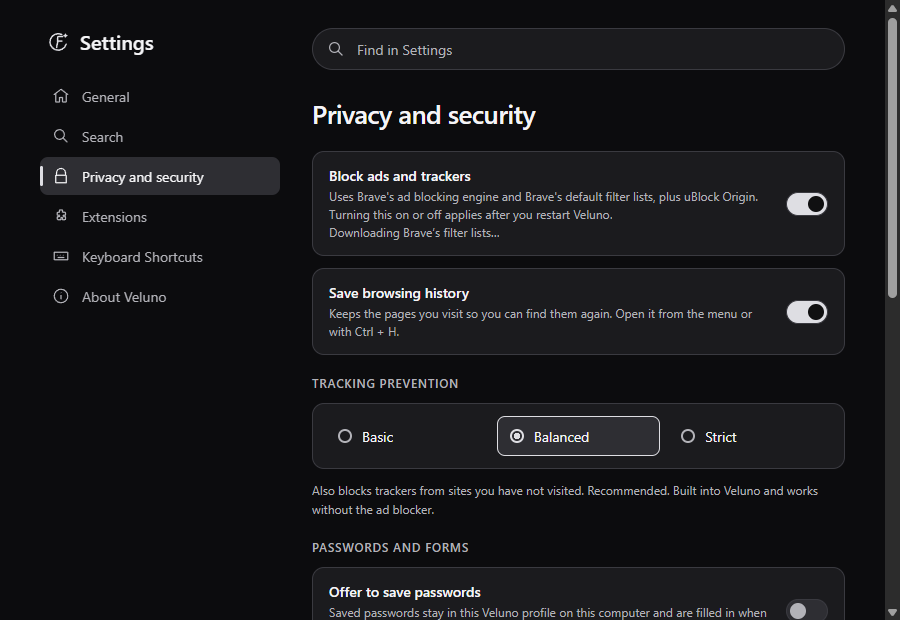

# Brave ad blocking evidence

Settings > Privacy and security, captured from isolated test profiles with `tests/native_app.py`. `before-privacy.png` is `origin/main`; `after-privacy.png` is this branch. The test app runs in smoke mode, which skips downloads, so the after capture shows the line Veluno displays until Brave's filter lists finish their first download.

