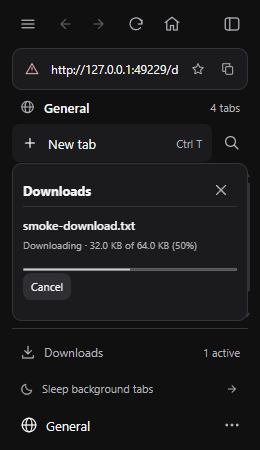
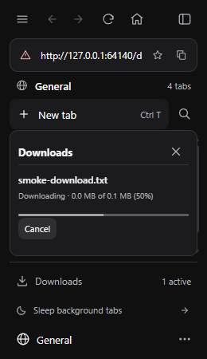
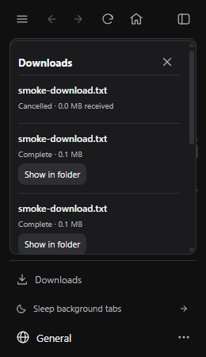

# Download progress units and completion

Downloads previously displayed byte counts formatted only in kilobytes (KB). When transfers finished receiving all bytes, download items could remain stuck showing in-progress status with a 100% progress bar and cancel button instead of completing, leaving active download counts non-zero and blocking tabs from closing.

Downloads now format progress and totals in megabytes (MB). Once all bytes arrive or the operation reports completion, download items transition to complete, show the folder action, remove progress bars, clear active counts, and allow closing their tab without warning.

| Before | After |
| --- | --- |
|  |  |
|  |  |

Captured via `tests/native_downloads.py` with local HTTP fixtures running in isolated WebView2.
